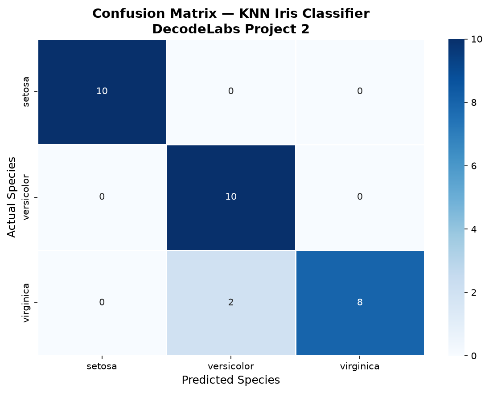

# Iris KNN Classifier

Supervised learning pipeline that trains a K-Nearest Neighbors classifier on the Iris dataset with scikit-learn. Built for the DecodeLabs AI Industrial Training (Batch 2026), Project 2.



## What It Does

- Loads and summarizes the Iris dataset (150 samples, 4 features, 3 classes)
- Scales features with `StandardScaler`
- Splits the data 80/20 with stratification (`random_state=42`)
- Trains a KNN model (K = 5) and predicts on unseen data
- Evaluates with a confusion matrix and weighted F1 score
- Finds a good K with an error-rate (elbow) curve
- Includes a function to predict a custom flower from its measurements

## Results

| Metric | Result |
|---|---|
| Test accuracy | About 96-97% |
| Weighted F1 score | About 0.97 |

The test set is only 30 samples, and Iris is a small, well-separated benchmark dataset. The numbers show the pipeline works, not that the model is production-ready.

## Dataset and Model

| Property | Value |
|---|---|
| Dataset | Iris (`sklearn.datasets.load_iris`) |
| Samples | 150 (50 per class) |
| Features | Sepal length and width, petal length and width |
| Classes | Setosa, Versicolor, Virginica |
| Algorithm | K-Nearest Neighbors, K = 5 |
| Train / test split | 120 / 30 samples |

## Output Files

| File | Description |
|---|---|
| `confusion_matrix.png` | Prediction results per class |
| `k_optimization.png` | Elbow curve for choosing K |
| `feature_analysis.png` | Feature distributions and scatter plot |

## Run

Requires Python 3.7 or newer.

```bash
git clone https://github.com/ash-1212/iris-knn-classifier.git
cd iris-knn-classifier
pip install -r requirements.txt
python classifier.py
```

## Concepts Practiced

- Supervised learning and train/test splitting
- Feature scaling for distance-based models
- Avoiding data leakage
- Reading confusion matrices and F1 scores
- Hyperparameter tuning with an elbow curve

## Author

**Ayesha Nazish**
DecodeLabs AI Industrial Training, Batch 2026.
[GitHub](https://github.com/ash-1212) · [LinkedIn](https://www.linkedin.com/in/ayeshanazish-452048274)